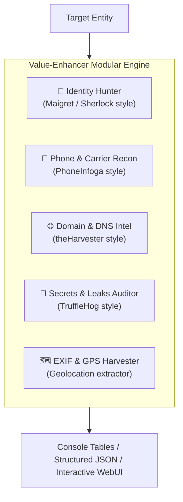

# 🛰️ Value-Enhancer

> **High-Performance Unified OSINT & Digital Reconnaissance Suite**  
> *Engineered for fast, lightweight, on-premise security auditing, digital footprint discovery, and defensive intelligence gathering.*

---

## ⚡ Overview

**Value-Enhancer** is a modular, high-speed reconnaissance and digital exposure audit framework. Inspired by tools like **Maigret**, **PhoneInfoga**, **theHarvester**, and **TruffleHog**, it integrates multi-vector OSINT capabilities into a single, low-overhead engine with both a sleek terminal CLI and an interactive local web dashboard.

Optimized to run seamlessly on low-spec hardware (including low-spec Windows 11 machines and lightweight Linux containers) with minimal memory footprint (<60MB RAM) and zero heavy GPU dependencies.

---

## 🛠️ Reconnaissance Vectors



1. **👤 Identity Hunter (`identity`) - Maigret Architecture**:
   - Asynchronous multi-platform profile scanner querying 35+ developer, gaming, social, and tech platforms in parallel.
   - Deep metadata parser: extracts display names, bio descriptions, avatar photos, locations, and cross-referenced social handles (`@handle`).
   - Maps the "Web of Identity" to discover interconnected accounts and calculate exposure scores.

2. **📱 Carrier & Phone Recon (`phone`) - PhoneInfoga Architecture**:
   - Parses international telephone numbers using Google's `libphonenumber` standard with default Alberta / Canadian regional parsing (`403`, `780`, `587`, `825`, `368`).
   - Detects telecom carriers, wire centers, country locations, and line types (e.g., Mobile, Fixed Line, or VOIP burner numbers).
   - Generates targeted Google OSINT dorks for web presence correlation.

3. **🌐 Domain & Infrastructure Recon (`domain`) - theHarvester Architecture**:
   - Passive **Certificate Transparency (crt.sh)** harvesting: retrieves real active subdomains from historical and current SSL cert issuance logs.
   - Exposed corporate email harvester via public PGP keyservers and DNS TXT/SOA records.
   - Cloud & CDN Provider fingerprinting (Cloudflare, AWS CloudFront, Google Cloud, Azure, Fastly).
   - Full DNS mapping (A, AAAA, MX, NS) and **DMARC / SPF Spoofability Grading** (A+ to F).

4. **🔑 Secrets & Leaks Auditor (`secrets`) - TruffleHog Architecture**:
   - Shannon Entropy analysis to detect high-entropy keys, passwords, and tokens.
   - Pattern matching for AWS keys, GitHub PATs, private certificates, Google API keys, Slack tokens, and JWTs.
   - Automatic secret masking to avoid plaintext terminal leaks.

5. **🗺️ EXIF & GPS Harvester (`metadata`)**:
   - Extracts camera hardware makes, models, software versions, and creation timestamps.
   - Decodes DMS GPS tags into decimal latitude/longitude with direct Google Maps links.

6. **📁 Automated Reports (`reports/`)**:
   - Every scan automatically generates a timestamped structured JSON dump and an executive Markdown summary in the `reports/` folder.

---

## 🚀 Quickstart

### 1. Installation

Clone the repository and install dependencies using `pip` or `uv`:

```bash
git clone https://github.com/obenalorenz-max/value-enhancer.git
cd value-enhancer

# Create and activate virtual environment
python -m venv .venv

# On Windows:
.venv\Scripts\activate

# On Linux/macOS:
source .venv/bin/activate

# Install requirements
pip install -r requirements.txt
```

---

### 2. Command Line Usage (CLI)

#### 👤 Scan Digital Footprint (Username)
```bash
python -m value_enhancer.cli identity torvalds
```

#### 📱 Analyze Phone Number
```bash
python -m value_enhancer.cli phone "+639171234567"
```

#### 🌐 Audit Domain & DNS Security
```bash
python -m value_enhancer.cli domain github.com
```

#### 🔑 Audit Code / Files for Leaked Credentials
```bash
python -m value_enhancer.cli secrets ./src
```

#### 🗺️ Extract GPS & Camera Metadata from Image
```bash
python -m value_enhancer.cli metadata photo.jpg
```

*Tip: Pass `--json-out` to any command for pipeline scripting and machine-readable output.*

---

### 3. Local Web Dashboard

Launch the embedded web dashboard:

```bash
python -m value_enhancer.cli web --port 8000
```

Open `http://localhost:8000` in your browser to access the tactical cyber console with drag-and-drop file uploads, live scan progress bars, and instant risk scoring.

---

## 🧪 Running Automated Tests

Run the test suite using `pytest`:

```bash
PYTHONPATH=src pytest -v tests/
```

---

## ⚖️ Ethical & Legal Disclaimer

*Value-Enhancer is built strictly for educational, defensive security auditing, and authorized open-source intelligence research. All queries utilize public endpoints and open records. Users are responsible for complying with all applicable local, national, and international laws.*

---

## 📄 License

MIT License. Developed for open security research.
